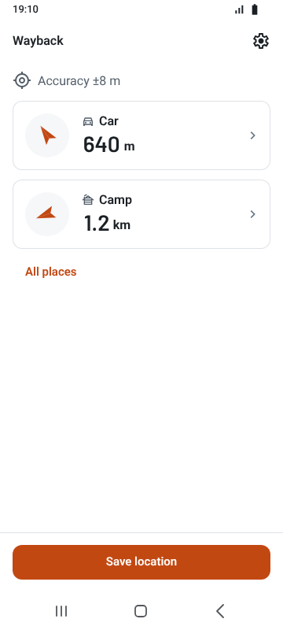
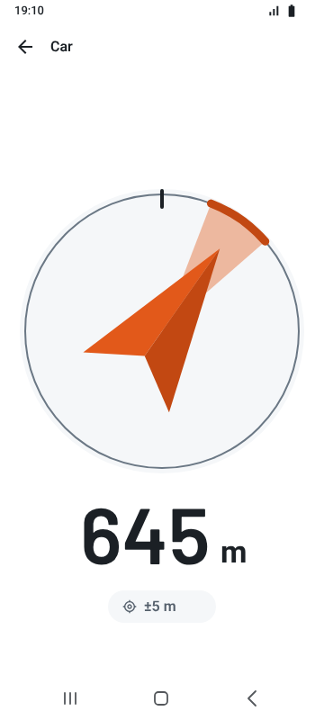
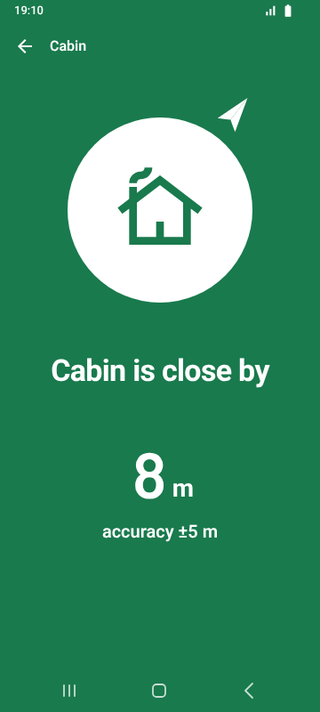
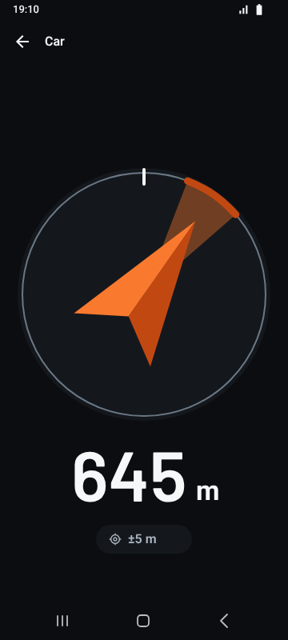
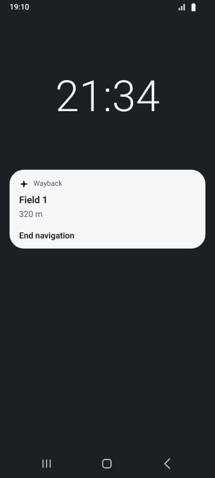

<p align="right"><b>English</b> · <a href="README.ru.md">Русский</a></p>

# Wayback

> Save a place. Find your way back.

<p align="center">
  <a href="https://github.com/Dogayo/wayback/releases/latest"></a>
  <a href="https://dogayo.github.io/wayback/"></a>
  <a href="https://design.penpot.app/?screen=viewer&amp;file-id=19c47d73-0a5d-8067-8008-be027d34cca0&amp;page-id=19c47d73-0a5d-8067-8008-be027d34cca1&amp;section=interactions&amp;frame-id=1891fb5b-b3e9-8060-8008-edb627103af7&amp;index=0&amp;share-id=89c7d7f8-4438-4ec1-82f2-cce2f2e07e56"></a>
</p>

<p align="center">
  <a href="https://github.com/Dogayo/wayback/releases"></a>
  
  
  <a href="LICENSE"></a>
</p>

Wayback is an offline-first Flutter app for returning to a saved spot — a parked
car, a tent, a fishing place — with nothing but GPS and the compass. It does not
build a route: it shows an arrow pointing at the saved spot and the distance
left, and it keeps working in the woods without a mobile network.

<!-- Media: a short GIF of the arrow in use goes above the screenshots. -->

<p align="center">
  
  
  
  
  
</p>

<p align="center"><sub>Home · Navigation · Arrival · Dark theme · Lock screen. The app speaks English and Russian.</sub></p>

## Features

- Save the current location in one tap, then name it and pick a type.
- An arrow and live distance to the point, with no internet and no maps.
- An honest signal: GPS accuracy is always shown, with warnings for a weak fix
  and an uncalibrated compass; without a compass, distance only.
- Arrival message and vibration when the point is near.
- Several active points on the home screen; share a point with someone else.
- Navigation keeps going with the screen off (Android foreground service).
- Russian and English, metric and imperial units, light and dark themes.

## Engineering highlights

- **Feature-first clean architecture.** `app → features → core`, each feature
  split into `data / domain / view`. The domain layer is plain Dart; repositories
  return `Result<T>` with typed failures instead of throwing.
- **Bloc with base blocs.** Only Bloc, one bloc per action or component.
  `DataBloc`, `ActionBloc` and `ListBloc` fix concurrency (restartable, droppable)
  and model state as sealed classes, so a screen cannot miss the loading or
  error case.
- **Own packages** in [`packages/`](packages):
  - [`wayback_design_system`](packages/wayback_design_system) — semantic tokens,
    light and dark themes through `ThemeExtension`, platform-adaptive components,
    an interactive catalog app and tests;
  - [`app_di`](packages/app_di) — a small service locator without codegen,
    with named containers and a Flutter bridge;
  - [`app_logger`](packages/app_logger) — an on-device JSONL diagnostic log with
    rotation, which strips private fields such as coordinates on export.
- **A compass arrow that does not lie.** Rotation follows the shortest arc, so
  the arrow never spins round at north; compass and GPS reliability are part of
  the domain model, not an afterthought in the UI.
- **Privacy by design.** No backend, no analytics, no account. Coordinates never
  leave the phone unless the user shares a point.
- **Tested and checked in the field.** 500+ unit, bloc and widget tests across
  the app and packages; every feature is checked on a real device
  before it is merged.
- **Tag-driven releases.** A `v<version>` tag builds a signed Android APK and
  publishes a GitHub Release, with notes taken from
  [`CHANGELOG.md`](CHANGELOG.md). CI refuses a tag that disagrees with
  `pubspec.yaml` or the changelog.

## Documentation

| Document | What's inside |
| --- | --- |
| [Product spec](docs/product.md) | the problem, scenarios, MVP, UX principles |
| [MVP scope](docs/mvp-scope.md) | done criteria for the MVP release |
| [Architecture](docs/architecture.md) | layers, blocs, errors, DI, rules for AI agents |
| [Screens](SCREENS.md) | every screen, its transitions and states |
| [Design system](DESIGN_SYSTEM.md) | tokens, motion, haptics, components |
| [Mockups in Penpot](https://design.penpot.app/?screen=viewer&file-id=19c47d73-0a5d-8067-8008-be027d34cca0&page-id=19c47d73-0a5d-8067-8008-be027d34cca1&section=interactions&frame-id=1891fb5b-b3e9-8060-8008-edb627103af7&index=0&share-id=89c7d7f8-4438-4ec1-82f2-cce2f2e07e56) | screens, components, app icon and motion; view only |
| [Interface copy](docs/copy.md) | voice, terms and every UI string in ru and en |

## Tech stack

Flutter · Dart 3 · flutter_bloc · go_router · geolocator · flutter_compass ·
flutter_foreground_task · shared_preferences · gen-l10n · GitHub Actions

## Project layout

```text
lib/
├── app/         # composition: DI, routing, theme, localization, bootstrap
├── core/        # base blocs, Result, errors, geo utils, shared widgets
└── features/    # location, points, navigation, settings, onboarding
packages/
├── wayback_design_system/
├── app_di/
└── app_logger/
```

## Running

```bash
flutter pub get
flutter run
```

The design system catalog:

```bash
cd packages/wayback_design_system/example
flutter run
```

Or open it in the browser: [dogayo.github.io/wayback](https://dogayo.github.io/wayback/).

Checks, run in the app and in each package:

```bash
flutter analyze
flutter test
```

## How it is built

Every change goes through the same steps: a written plan, mockups in Penpot,
code, a check on a real device, then a pull request. The project is developed
together with AI coding agents; the rules they follow live in
[`AGENTS.md`](AGENTS.md) and [`docs/architecture.md`](docs/architecture.md).

## License

[MIT](LICENSE)
