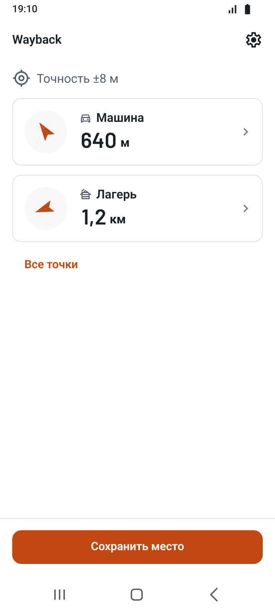
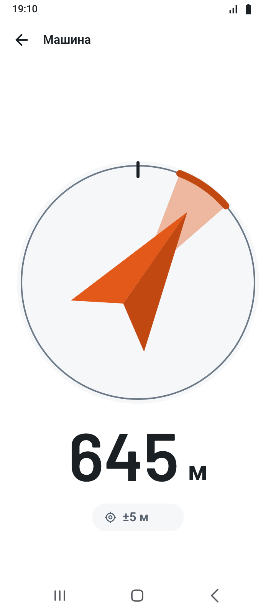
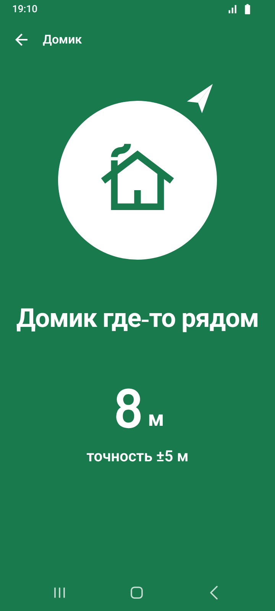
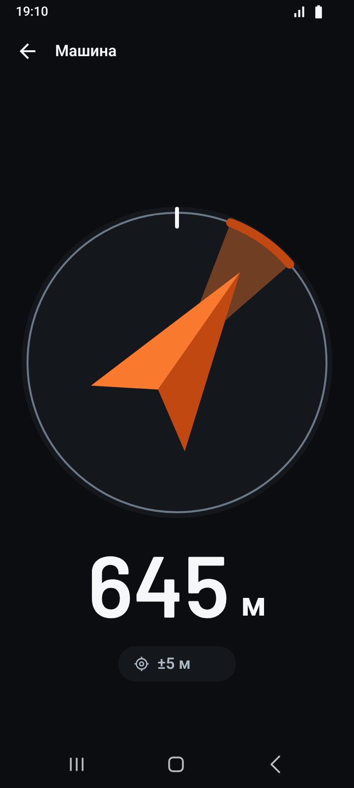

<p align="right"><a href="README.md">English</a> · <b>Русский</b></p>

# Wayback

> Сохрани место. Найди дорогу обратно.

<p align="center">
  <a href="https://github.com/Dogayo/wayback/releases/latest"></a>
  <a href="https://dogayo.github.io/wayback/"></a>
</p>

<p align="center">
  <a href="https://github.com/Dogayo/wayback/releases"></a>
  
  
  <a href="LICENSE"></a>
</p>

Wayback — офлайн-приложение на Flutter, которое помогает вернуться к сохранённому
месту: к машине у леса, палатке, месту рыбалки. Оно не строит маршрут, а
показывает стрелку на точку и оставшееся расстояние — только по GPS и компасу,
без мобильной сети.

<!-- Медиа: короткая GIF со стрелкой в работе ставится над скриншотами. -->

<p align="center">
  
  
  
  
  
</p>

<p align="center"><sub>Главный экран · Навигация · Прибытие · Тёмная тема · Экран блокировки</sub></p>

## Возможности

- Сохранение текущего места одним нажатием, затем название и тип точки.
- Стрелка и расстояние до точки в реальном времени, без интернета и карт.
- Честный сигнал: точность GPS видна всегда, есть предупреждения о слабом
  сигнале и некалиброванном компасе; без компаса — только расстояние.
- Сообщение и вибрация, когда точка рядом.
- Несколько активных точек на главном экране; точкой можно поделиться.
- Навигация продолжается при выключенном экране (foreground service на Android).
- Русский и английский, метрические и имперские единицы, светлая и тёмная темы.

## Инженерные решения

- **Feature-first clean architecture.** `app → features → core`, каждая фича
  разделена на `data / domain / view`. Слой domain — чистый Dart; репозитории
  возвращают `Result<T>` с типизированными ошибками, а не бросают исключения.
- **Bloc с базовыми блоками.** Только Bloc, один блок на действие или компонент.
  `DataBloc`, `ActionBloc` и `ListBloc` задают конкурентность (restartable,
  droppable) и описывают состояние sealed-классами, поэтому экран не может
  забыть про загрузку или ошибку.
- **Свои пакеты** в [`packages/`](packages):
  - [`wayback_design_system`](packages/wayback_design_system) — семантические
    токены, светлая и тёмная темы через `ThemeExtension`, платформо-адаптивные
    компоненты, интерактивный каталог и тесты;
  - [`app_di`](packages/app_di) — небольшой service locator без кодогенерации,
    с именованными контейнерами и мостом во Flutter;
  - [`app_logger`](packages/app_logger) — журнал диагностики на устройстве
    в JSONL с ротацией; при экспорте приватные поля, например координаты,
    вырезаются.
- **Стрелка компаса, которая не врёт.** Поворот идёт по кратчайшей дуге, поэтому
  стрелка не прокручивается на севере; надёжность компаса и GPS — часть
  доменной модели, а не надпись, добавленная в UI потом.
- **Приватность по умолчанию.** Нет бэкенда, аналитики и аккаунта. Координаты
  не покидают телефон, пока пользователь сам не поделится точкой.
- **Тесты и полевые проверки.** Больше 500 unit-, bloc- и widget-тестов в
  приложении и пакетах; каждая фича проверяется на реальном устройстве до
  слияния.
- **Релизы по тегам.** Тег `v<version>` собирает подписанный Android APK и
  публикует GitHub Release с описанием из [`CHANGELOG.md`](CHANGELOG.md).
  CI отклоняет тег, если он расходится с `pubspec.yaml` или чейнджлогом.

## Документация

| Документ | Что внутри |
| --- | --- |
| [Продуктовое ТЗ](docs/product.ru.md) | проблема, сценарии, MVP, принципы UX |
| [Объём MVP](docs/mvp-scope.ru.md) | критерии готовности MVP-релиза |
| [Архитектура](docs/architecture.ru.md) | слои, блоки, ошибки, DI, правила для AI-агентов |
| [Экраны](SCREENS.ru.md) | все экраны, переходы и состояния |
| [Дизайн-система](DESIGN_SYSTEM.ru.md) | токены, движение, отклик, компоненты |
| [Тексты интерфейса](docs/copy.ru.md) | голос, термины и все строки на ru и en |

## Стек

Flutter · Dart 3 · flutter_bloc · go_router · geolocator · flutter_compass ·
flutter_foreground_task · shared_preferences · gen-l10n · GitHub Actions

## Структура проекта

```text
lib/
├── app/         # композиция: DI, роутинг, тема, локализация, bootstrap
├── core/        # базовые блоки, Result, ошибки, geo-утилиты, общие виджеты
└── features/    # location, points, navigation, settings, onboarding
packages/
├── wayback_design_system/
├── app_di/
└── app_logger/
```

## Запуск

```bash
flutter pub get
flutter run
```

Каталог дизайн-системы:

```bash
cd packages/wayback_design_system/example
flutter run
```

Или в браузере: [dogayo.github.io/wayback](https://dogayo.github.io/wayback/).

Проверки — в приложении и в каждом пакете:

```bash
flutter analyze
flutter test
```

## Как ведётся разработка

Каждое изменение проходит одни и те же шаги: письменный план, макеты в Penpot,
код, проверка на реальном устройстве, затем пул-реквест. Проект разрабатывается
вместе с AI-агентами; правила, по которым они работают, лежат в
[`AGENTS.md`](AGENTS.md) и [`docs/architecture.md`](docs/architecture.ru.md).

## Лицензия

[MIT](LICENSE)
