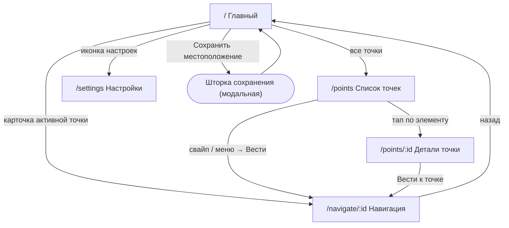

# Screens

Карта экранов Wayback: что за экраны существуют, что на каждом из них происходит, как они связаны и какие состояния обязан поддерживать каждый.

Документ рассчитан, как и [architecture.md](architecture.md), в первую очередь на AI-агентов: по нему должно однозначно решаться, **на каком экране живёт функция** и **какие состояния нужно отрисовать, чтобы экран считался готовым**.

Продуктовый контекст — [README.md](../README.md), объём — [mvp-scope.md](mvp-scope.md), слои и маршруты — [architecture.md](architecture.md), токены и компоненты — [DESIGN_SYSTEM.md](../DESIGN_SYSTEM.md).

---

## 1. Карта

Пять маршрутов, ровно как в [architecture.md §6](architecture.md). Отдельного маршрута для создания точки **нет** — см. §3.1.

Нижняя навигация не используется: разделов мало, и главный экран должен оставаться единственным центром. Между экранами ходим через app bar и явные действия.

---

## 2. Основной поток

Сценарий, ради которого существует приложение — `Save → Walk away → Navigate back`:

| # | Шаг | Экран | Что видит пользователь |
| --- | --- | --- | --- |
| 1 | Открывает приложение у машины | `/` | Кнопка сохранения, текущая точность GPS |
| 2 | Жмёт «Сохранить местоположение» | `/` | Haptic, снэкбар «Точка сохранена» с действием «Изменить» |
| 3 | (опционально) правит имя и тип | шторка | Поле имени, сетка типов 4×2 |
| 4 | Уходит | — | Приложение закрыто |
| 5 | Возвращается, открывает приложение | `/` | Карточка активной точки: направление и расстояние |
| 6 | Жмёт на карточку | `/navigate/:id` | Стрелка, расстояние, точность |
| 7 | Идёт | `/navigate/:id` | Стрелка и расстояние обновляются |
| 8 | Входит в радиус прибытия | `/navigate/:id` | Состояние «вы на месте», вибрация один раз |

Критическое требование: шаги 1–2 — **один тап** от запуска приложения, без промежуточных экранов и без обязательного ввода имени.

Весь поток обязан работать в авиарежиме.

---

## 3. Экраны

### 3.1 `/` — Главный

**Задача.** Сохранить точку за один тап и показать, где активная точка, — не заставляя никуда переходить.

**Содержание.**

- индикатор текущей точности GPS (`bodySmall`, вторично);
- карточка активной точки: имя, иконка типа, направление и расстояние — компактная версия навигации, тап ведёт на `/navigate/:id`;
- крупная Primary-кнопка «Сохранить местоположение»;
- вход в список точек и в настройки — в app bar.

**Состояния.**

| Состояние | Когда | Что показываем |
| --- | --- | --- |
| loading | холодный старт, ждём первый фикс | Skeleton вместо карточки, кнопка сохранения disabled + подпись «Определяем местоположение» |
| empty | точек нет (первый запуск) | Паттерн пустого состояния: иконка + заголовок + текст + Primary-кнопка сохранения |
| content | есть активная точка | Карточка активной точки + кнопка сохранения |
| error | нет разрешения, GPS недоступен, ошибка хранилища | Alert по `failure.code` (§5), кнопка сохранения disabled |

**Сохранение точки — как именно.** Отдельного экрана и маршрута `/points/new` нет намеренно: любой промежуточный экран ломает критерий «не более одного тапа». Тап по кнопке сразу создаёт точку с текущими координатами, дефолтным именем и типом `generic`, и она **становится активной**. Подтверждение — снэкбар с действием «Изменить», открывающим модальную шторку с именем и типом. Не тронул шторку — точка всё равно сохранена корректно.

**Haptics.** `HapticFeedback.lightImpact()` в момент сохранения.

### 3.2 `/points` — Список точек

**Задача.** Найти нужную точку и переключить активную.

**Содержание.** Список `AppListItem`: иконка типа, имя, расстояние от текущей позиции, признак активной (`selected`-состояние). Сортировка — сначала активная, дальше по дате создания, новые сверху.

**Действия.** Тап — переход на детали. Долгое нажатие / хвостовое меню — «Сделать активной», «Вести к точке», «Удалить». Удаление — всегда через подтверждение с названным последствием («Удалить точку „Машина“? Координаты будут потеряны»), не голое «Вы уверены?».

**Состояния.**

| Состояние | Что показываем |
| --- | --- |
| loading | Skeleton на 3–4 строки |
| empty | Пустое состояние с кнопкой возврата к сохранению |
| content | Список |
| error | Alert negative по `failure.code` + повтор |

**Граничные случаи.** Список обязан оставаться корректным на 0 и на 100+ записях; расстояния в строках пересчитываются при обновлении позиции, но не чаще, чем нужно для читаемости — дёргающиеся цифры в списке недопустимы.

### 3.3 `/points/:id` — Детали точки

**Задача.** Посмотреть и отредактировать одну точку. Цель deep-link.

**Содержание.** Имя (редактируемое), тип (сетка 4×2), координаты, дата создания, расстояние. Действия: «Вести к точке» (Primary), «Сделать активной», «Удалить» (destructive).

**Состояния.** loading — Skeleton; content — карточка; error — точка не найдена (`NotFoundFailure`, в том числе при переходе по устаревшему deep-link) → пустое состояние с возвратом в список.

### 3.4 `/navigate/:id` — Навигация

**Задача.** Ответить на два вопроса: **куда** и **сколько осталось**. Всё остальное на этом экране вторично.

**Содержание.**

- стрелка (`WbCompassArrow`), доминирует по площади;
- расстояние — `displayLarge`, табличные цифры, `< 1000 м` в метрах, дальше километры с одним знаком;
- имя точки — `headlineSmall`;
- точность GPS — `bodySmall`, вторично;
- предупреждения о компасе и сигнале — встроенный Alert warning, не модальный.

**Состояния.**

| Состояние | Когда | Что показываем |
| --- | --- | --- |
| loading | ждём первый фикс и первый heading | Стрелка в нейтральном положении + ProgressIndicator с подписью, без фальшивых нулей |
| content | всё есть | Стрелка + расстояние |
| arrival | расстояние ≤ порога прибытия | Явное «вы на месте», вибрация `mediumImpact()` **один раз** при первом входе в радиус |
| degraded | плохой сигнал / компас не откалиброван | Данные показываем, но с Alert warning; ничего не прячем |
| error | нет разрешения, компас недоступен, точка не найдена | Alert negative по `failure.code`, стрелка не отображается |

**Порог прибытия.** ~20 м с учётом текущей точности GPS, именованной константой — не магическим числом. При точности хуже порога честно сообщаем, что подтвердить прибытие нельзя.

**Что после прибытия.** Экран остаётся открытым, состояние прибытия не сбрасывается при мелких колебаниях позиции (иначе вибрация зациклится). Точка **не** удаляется автоматически; выход — кнопка возврата на главный.

**Жизненный цикл.** Подписки на позицию и компас останавливаются при уходе с экрана и при сворачивании приложения — это критерий MVP по батарее, а не оптимизация.

### 3.5 `/settings` — Настройки

**Задача.** Три переключателя, ничего больше.

**Содержание.** Сгруппированные `AppListItem`: единицы измерения (метрическая / имперская), язык (системный / ru / en), вибрация при прибытии (Switch). Внизу — версия приложения.

**Состояния.** content и error (ошибка сохранения настройки → снэкбар, значение откатывается). loading и empty не нужны: значения всегда имеют дефолт.

---

## 4. Модальные слои

Не экраны и не маршруты — живут поверх текущего экрана:

| Слой | Где | Назначение |
| --- | --- | --- |
| Шторка сохранения | `/` | Имя + тип только что сохранённой точки |
| Диалог подтверждения удаления | `/points`, `/points/:id` | Деструктивное действие с названным последствием |
| Диалог разрешения | `/`, `/navigate/:id` | Системный запрос и объяснение до него |
| Снэкбар | любой | Подтверждение сохранения, ошибка настройки |

---

## 5. Сквозные состояния

Эти состояния возникают на нескольких экранах и проектируются один раз, а не по месту. Каждому соответствует пара `Failure.code` → ключ `error_<code>` в ARB ([architecture.md §4.2](architecture.md)).

| Ситуация | Где возникает | Поведение |
| --- | --- | --- |
| Разрешение не запрошено | `/`, первый запуск | Объяснение зачем → системный запрос. Не запрашиваем на пустом месте, без контекста |
| Разрешение отклонено | `/`, `/navigate/:id` | Alert с объяснением и кнопкой повторного запроса |
| Отклонено навсегда | там же | Alert + переход в системные настройки приложения |
| GPS недоступен / сигнал плохой | `/`, `/navigate/:id` | Явное состояние. Нули и старые значения выдавать за актуальные запрещено |
| Компас недоступен | `/navigate/:id` | Расстояние показываем, стрелку — нет, с объяснением |
| Компас требует калибровки | `/navigate/:id` | Alert warning, данные не прячем |
| Ошибка хранилища | `/points`, `/` | Alert negative + повтор |

Общее правило: **приложение честно сообщает о плохих данных вместо тишины, нулей и фальшивой уверенности** — это продуктовый принцип, а не деталь реализации.

---

## 6. Принятые решения

Вопросы, оставленные открытыми в [DESIGN_SYSTEM.md](../DESIGN_SYSTEM.md), закрываются здесь. Решения изменяемы, но менять их нужно осознанно и в этом файле.

| Вопрос | Решение | Почему |
| --- | --- | --- |
| Как триггерится сохранение при отсутствии `/points/new` | Кнопка на `/` сохраняет сразу; редактирование — опциональная шторка после | Любой промежуточный экран ломает критерий «один тап» |
| Одна активная точка или несколько | Одна | Экран навигации отвечает на один вопрос; несколько целей — post-MVP |
| Становится ли новая точка активной | Да | Основной сценарий — сохранил и ушёл именно от неё |
| Что после прибытия | Экран остаётся, точка не удаляется, вибрация один раз | Автоудаление необратимо и непредсказуемо для пользователя |
| Карта в MVP | Нет | Non-goal по README; требует сети и ломает offline-first |
| Единицы измерения по умолчанию | По локали устройства, переопределяются в настройках | Не спрашиваем на первом запуске — это лишний шаг до ценности |

---

## 7. Вне карты

Не проектируется в MVP: онбординг (кроме объяснения разрешения по месту), экран «о приложении», редактирование координат вручную, экспорт/импорт, история посещений, breadcrumb trail, виджеты и часы.

---

## 8. Критерий готовности экрана

Экран считается готовым, когда:

1. отрисованы **все** состояния из его таблицы, включая ошибочные;
2. каждая пользовательская строка приходит из `l10n`, включая тексты ошибок;
3. каждая ошибка имеет `code` и ключ `error_<code>` в обоих ARB;
4. использованы только токены и компоненты дизайн-системы — произвольных hex/px нет;
5. область нажатия любого интерактивного элемента ≥44×44dp;
6. экран читаем при масштабе текста 200% и в тёмной теме;
7. подписки на датчики останавливаются при уходе с экрана.
